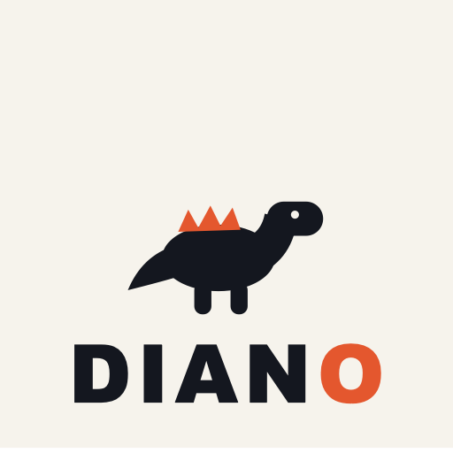

# DIANO — Chrome New Tab Runner

  

Chrome ke **new tab** pe DIANO runner. Jump cacti, duck birds, beat your high score.

## Install

1. Open `chrome://extensions`
2. Enable **Developer mode**
3. **Load unpacked** → select this folder
4. Pin the **DIANO** icon
5. Open a **new tab** to play

## Popup controls

- **Game on new tab** — On/Off
- **Sound effects** — jump / duck / hit / score
- **Jump / Duck keys** — remap
- **High score reset**

New tab pe top-right **✕** → Chrome default new tab / Google.

## Default keyboard

| Action | Keys |
|---|---|
| Jump / Start / Retry | `Space`, `↑` |
| Duck | `↓` |

## Brand

Logo + icons: `icons/logo.svg`, `icons/icon.svg`, PNG sizes in `icons/`.
