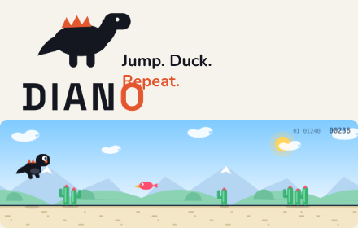
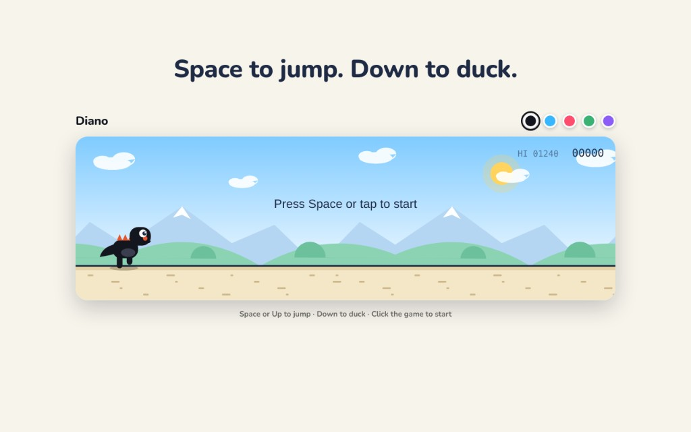

<p align="center">
  
</p>

<h1 align="center">DIANO</h1>

<p align="center">
  <strong>Jump. Duck. Repeat.</strong><br/>
  A smooth runner game in every new Chrome tab.
</p>

<p align="center">
  <a href="https://beingamit4197.github.io/diano/"></a>
  <a href="https://github.com/beingamit4197/diano"></a>
  
</p>

---

## Links

| Page | URL |
|---|---|
| **Homepage** | https://beingamit4197.github.io/diano/ |
| **Support** | https://beingamit4197.github.io/diano/support.html |
| **Privacy Policy** | https://beingamit4197.github.io/diano/privacy.html |
| **Repository** | https://github.com/beingamit4197/diano |

Use these URLs in the Chrome Web Store listing (Homepage / Support / Privacy).

---

## Promo

<p align="center">
  
</p>

<p align="center">
  
</p>

---

## Screenshots

### Gameplay


### Night mode


### Game over


### Skins


### Controls


<p align="center">
  
</p>

---

## Features

- Runner on every **new tab**
- Jump cacti, duck birds, beat your **HI** score
- Day → night as the score climbs
- **Sound effects** (jump, duck, hit, score)
- Remappable **keyboard controls**
- Runner **colour skins**
- Toolbar popup: game On/Off, sound On/Off, high-score reset
- Top-right **✕** to return to Chrome / Google
- Preferences saved locally (no account)

---

## Install (developer mode)

1. Open `chrome://extensions`
2. Enable **Developer mode**
3. Click **Load unpacked** and select this folder
4. Pin **DIANO**
5. Open a **new tab** to play

---

## Default controls

| Action | Keys |
|---|---|
| Jump / Start / Retry | `Space`, `↑` |
| Duck | `↓` |
| Click / tap canvas | Jump / start |

Change keys anytime from the extension popup.

---

## Project structure

```text
diano/
├── manifest.json          # Chrome MV3 extension
├── newtab.html / .js      # New tab (game or search fallback)
├── game.js                # Runner engine
├── sounds.js              # Web Audio SFX
├── popup.html / .css / .js
├── icons/                 # Extension + brand icons
├── store-assets/          # Chrome Web Store graphics
└── docs/                  # GitHub Pages (landing, support, privacy)
```

---

## Chrome Web Store assets

Upload from `store-assets/`:

| Asset | File |
|---|---|
| Store icon (128×128) | `store-assets/store-icon-128.png` |
| Marquee promo | `store-assets/promo-marquee.jpg` |
| Small promo | `store-assets/promo-small.jpg` |
| Screenshots | `store-assets/screenshot-1` … `screenshot-5` |

Listing copy helpers: `STORE_LISTING.md`

---

## Privacy

DIANO stores only local preferences and high score in Chrome storage.  
Full policy: https://beingamit4197.github.io/diano/privacy.html

---

<p align="center">
  Made for quick breaks between tabs.
</p>
