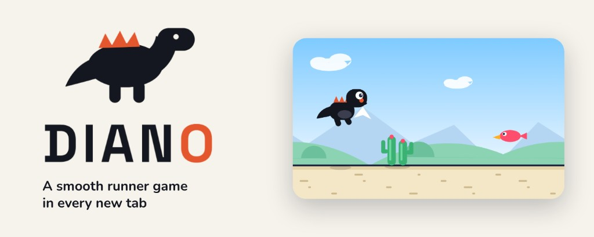
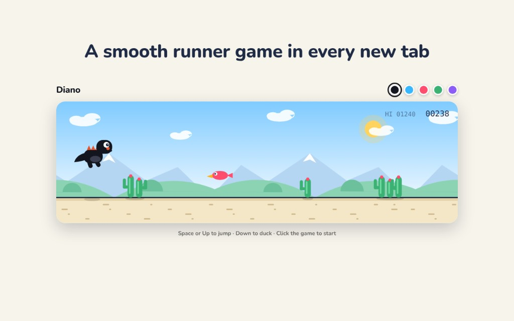
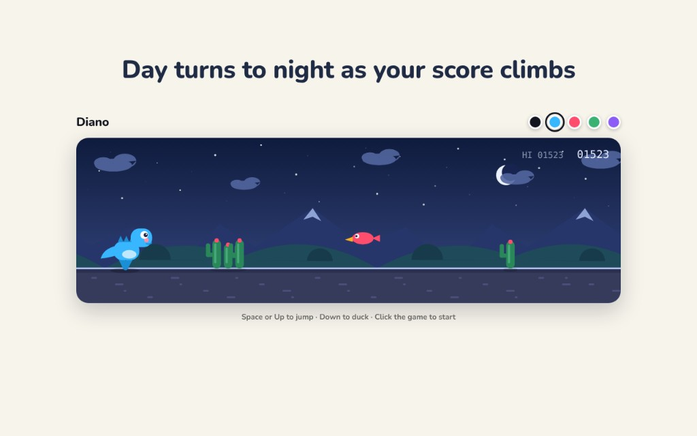
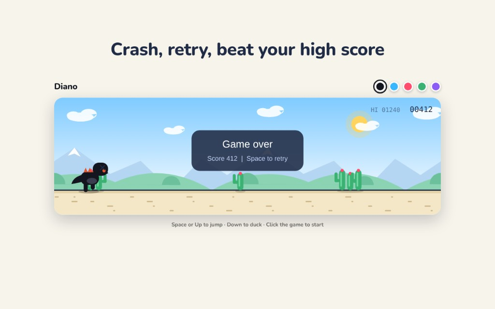
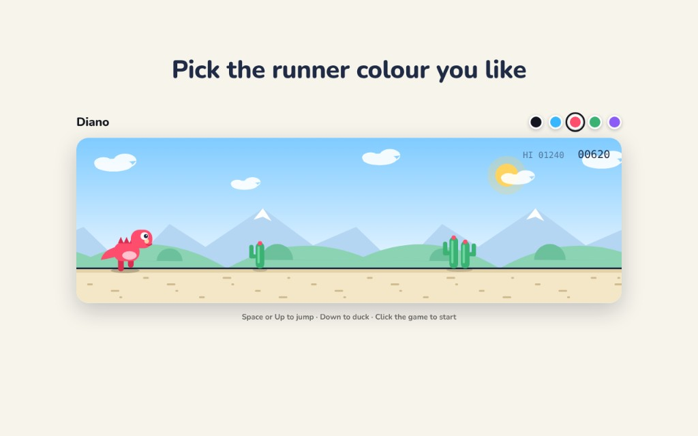

# DIANO — Chrome New Tab Runner

  

**Jump. Duck. Repeat.** — a smooth runner game in every new Chrome tab.

## Links

| | URL |
|---|---|
| **Homepage** | https://beingamit4197.github.io/diano/ |
| **Support** | https://beingamit4197.github.io/diano/support.html |
| **Privacy** | https://beingamit4197.github.io/diano/privacy.html |
| **GitHub** | https://github.com/beingamit4197/diano |

## Screenshots

  

## Install

1. Open `chrome://extensions`
2. Enable **Developer mode**
3. **Load unpacked** → this folder
4. Pin **DIANO**
5. Open a **new tab**

## Popup

- Game on new tab On/Off
- Sound effects On/Off
- Remap Jump / Duck keys
- High score reset

New tab ✕ → Chrome / Google pe wapas.
